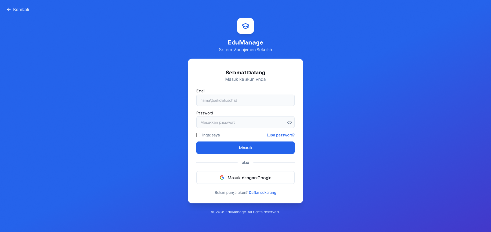
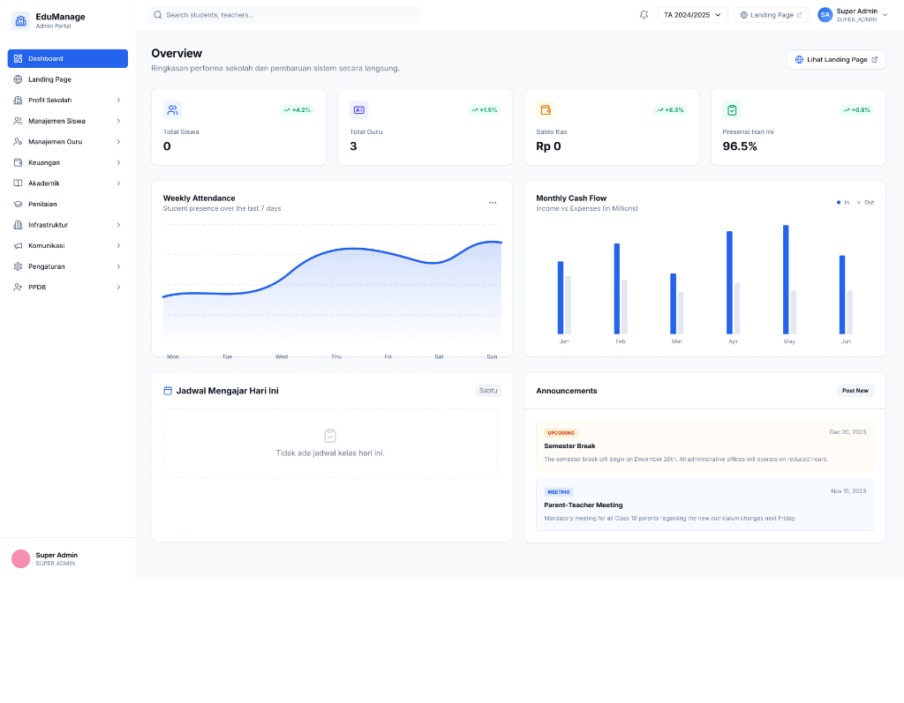
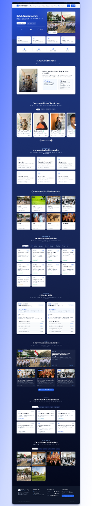

# EduManage - Sistem Informasi Manajemen Sekolah Terpadu & Portal Publik

<div align="center">



[](https://reactjs.org/)
[](https://www.typescriptlang.org/)
[](https://vitejs.dev/)
[](https://tailwindcss.com/)
[](https://nodejs.org/)
[](https://www.prisma.io/)
[](LICENSE)

<p align="center">
  <strong>Solusi Digital Enterprise Terintegrasi untuk Tata Kelola Administrasi Sekolah, Akademik Kurikulum Merdeka, Manajemen Kesiswaan, Keuangan, PPDB, dan Portal Informasi Publik.</strong>
</p>

</div>

---

## 📑 Daftar Isi

- [Preview Visual Aplikasi](#-preview-visual-aplikasi)
- [Fitur Utama Sistem](#-fitur-utama-sistem)
- [Matriks Hak Akses & Peran Pengguna (RBAC)](#-matriks-hak-akses--peran-pengguna-rbac)
- [Akun Demo Bawaan (Default Credentials)](#-akun-demo-bawaan-default-credentials)
- [Arsitektur Monorepo](#-arsitektur-monorepo)
- [Dokumentasi REST API Endpoints](#-dokumentasi-rest-api-endpoints)
- [Panduan Instalasi & Menjalankan](#-panduan-instalasi--menjalankan)
- [Roadmap Sprint](#-roadmap-sprint)
- [Troubleshooting & FAQ](#-troubleshooting--faq)
- [Lisensi](#-lisensi)

---

## 📸 Preview Aplikasi

Dokumentasi tangkapan layar antarmuka sistem EduManage:

### 1. Dashboard Utama Admin & Ringkasan Performa
Pusat monitoring metrik vital sekolah: total siswa aktif, jumlah pendidik/guru, saldo kas operasional, persentase kehadiran harian, grafik absensi mingguan, arus kas bulanan (*Cash Flow In/Out*), jadwal mengajar aktif, dan pengumuman instansi.

<div align="center">
  
</div>

---

### 2. Portal Resmi Publik & Landing Page Sekolah
Halaman depan resmi sekolah yang modern dan elegan, dilengkapi:
- Banner Hero sinematik dengan badge akreditasi BAN-S/M dan akses cepat tombol PPDB.
- Sambutan Pimpinan / Kepala Sekolah & Visi Misi institusi.
- Jajaran Pimpinan & Dewan Manajemen (filter: Pimpinan, Bidang MGMP, Komite).
- Kurikulum & Program Akademik Unggulan serta daftar ekstrakurikuler.
- Sarana & Prasarana Kampus (Laboratorium, Ruang Kelas, Lapangan Olahraga).
- Bagian **Organisasi Siswa (OSIS & MPK)** dinamis langsung terhubung ke profil database sekolah.
- **Trending News Docket**: Panel berkas warta fisik sticky dengan tab bookmark (*NEWSLETTER*) yang responsif (desktop tengah, mobile kiri bawah).
- Galeri dokumentasi kegiatan dan catatan prestasi penghargaan siswa.

<div align="center">
  
</div>

---

### 3. Halaman Login Terpadu & Autentikasi
Portal autentikasi tunggal dengan perlindungan JWT sesi aman, dukungan fitur *Remember Me*, pemulihan kata sandi, dan integrasi Google OAuth (*Single Sign-On*).

<div align="center">
  
</div>

---

## 🌟 Fitur Utama Sistem

### 🏛️ 1. Profil Sekolah & CMS Publik Terpadu
- **Identitas & Legalitas**: Pengaturan nama sekolah, NPSN, jenjang, status negeri/swasta, tahun akreditasi, visi misi, kontak, serta alamat kampus.
- **Struktur Manajemen Organisasi**: Pengelolaan bagan organisasi (Kepala Sekolah, Wakil Kepala Sekolah, MGMP, dan Komite Sekolah) lengkap dengan foto, NIP, serta peran jabatan.
- **Sarana & Prasarana**: Katalog fasilitas fisik sekolah dengan foto, kapasitas daya tampung, kondisi kelayakan, dan peruntukan ruang.
- **Organisasi Kesiswaan (OSIS & MPK)**: Data profil masa bakti, visi organisasi, misi utama, jumlah pengurus, serta status program kerja unggulan (*Terlaksana / Agenda*).
- **Galeri & Prestasi**: Dokumentasi visual kegiatan sekolah dan etalase raihan medali/penghargaan siswa di tingkat sekolah, kota, provinsi, hingga nasional.

### 📰 2. Portal Berita & Warta Sekolah
- **Manajemen Artikel (Admin Dashboard)**: CRUD warta sekolah dengan editor teks kaya, upload gambar cover, pemilihan kategori, ringkasan *excerpt*, serta status *Draft/Published*.
- **Portal Berita Publik (`/berita`)**: Halaman khusus pembaca dengan pencarian teks langsung, filter kategori berita (*Akademik, Prestasi, Kegiatan OSIS, Pengumuman*), dan sorting waktu.
- **Detail Berita SEO-Friendly (`/berita/:slug`)**: Halaman artikel mendalam dengan URL berbasis slug yang ramah mesin pencari.
- **Sticky Trending News Docket**: Panel berita populer & trending yang menempel pada layar menyerupai berkas fisik dengan penanda tab buku (*bookmark*), mudah dibuka kapan saja saat membaca halaman depan.
- **Pelacak Pembaca Unik (Cookie Consent)**: Algoritma perhitungan view artikel unik per pembaca dengan banner persetujuan cookie (*GDPR/UU Perlindungan Data Pribadi* compliant).

### 📚 3. Akademik & Kurikulum Merdeka
- **Learning Management System (LMS)**: Distribusi materi pembelajaran, modul ajar, penugasan siswa, dan pengunggahan berkas jawaban tugas.
- **Asesmen & Penilaian**:
  - Penilaian Formatif & Sumatif.
  - Penilaian Capaian Tujuan Pembelajaran (TP).
  - Penilaian Proyek Penguatan Profil Pelajar Pancasila (P5).
- **E-Rapor Digital**: Perhitungan nilai akhir otomatis, catatan wali kelas, dan pencetakan lembar rapor dalam format PDF terstandar.

### 👥 4. Kesiswaan, Guru, & Kepegawaian
- **Database Induk Siswa & GTK**: Penyimpanan nomor NISN, NIK, tempat/tanggal lahir, data orang tua/wali, serta status kepegawaian.
- **Presensi Digital Harian**: Absensi kehadiran siswa dan guru dengan rekapitulasi persentase harian serta mingguan.
- **Jadwal Mengajar**: Penjadwalan mata pelajaran, alokasi jam mengajar per kelas, dan status guru piket.
- **Import Siswa Massal**: Fitur import data siswa melalui template spreadsheet Excel untuk efisiensi awal tahun ajaran.

### 💰 5. Administrasi Keuangan & Sarpras
- **Billing SPP & Uang Sekolah**: Pembuatan tagihan berkala, pelacakan tunggakan, serta kwitansi bukti pembayaran.
- **Manajemen Kas & Arus Keuangan**: Pencatatan pemasukan dan pengeluaran operasional sekolah dengan grafik komparasi bulanan.
- **Penggajian Staf & Guru**: Penghitungan honorarium jam mengajar dan tunjangan jabatan.
- **Inventaris Ruangan**: Pendataan nomor kode barang aset sekolah, kondisi fisik (baik/rusak), serta pelaporan tiket pemeliharaan.

### 🎒 6. Penerimaan Peserta Didik Baru (PPDB Online)
- **Pendaftaran Mandiri Online**: Formulir pendaftaran calon peserta didik lengkap dengan unggah berkas persyaratan (Akta, KK, Ijazah/SKL).
- **Pengaturan Gelombang**: Manajemen kuota pendaftaran, jadwal seleksi berkas, dan pengumuman hasil kelulusan.

---

## 🔐 Matriks Hak Akses & Peran Pengguna (RBAC)

| Modul / Fitur | SUPER_ADMIN | PRINCIPAL (Kepsek) | TEACHER (Guru) | STAFF (TU) | STUDENT (Siswa) | PARENT (Wali) |
| :--- | :---: | :---: | :---: | :---: | :---: | :---: |
| **Dashboard Utama Eksekutif** | ✅ Penuh | ✅ Ringkasan | ❌ | ❌ | ❌ | ❌ |
| **Manajemen Profil & CMS Landing Page** | ✅ Penuh | 👁️ Lihat | ❌ | 👁️ Lihat | ❌ | ❌ |
| **Manajemen Berita & Artikel** | ✅ Penuh | ✅ Penuh | ✏️ Buat Draf | ✏️ Buat Draf | ❌ | ❌ |
| **Data Induk Siswa & Guru** | ✅ Penuh | 👁️ Lihat | 👁️ Kelas Ajar | ✅ Penuh | ❌ | ❌ |
| **LMS, Tugas, & Modul Ajar** | ✅ Kelola | 👁️ Monitoring | ✅ Penuh | ❌ | 📝 Kerjakan | 👁️ Pantau |
| **Input Nilai & E-Rapor** | ✅ Kelola | 👁️ Verifikasi | ✅ Input Nilai | 🖨️ Cetak | 👁️ Nilai Pribadi | 👁️ Nilai Anak |
| **SPP & Keuangan Sekolah** | ✅ Penuh | 👁️ Laporan Kas | ❌ | ✅ Billing/Kasir | 💳 Cek Tagihan | 💳 Bayar Tagihan |
| **Sarpras & Inventaris** | ✅ Penuh | 👁️ Audit | 🛠️ Lapor Rusak | ✅ Kelola Aset | ❌ | ❌ |
| **Pengaturan Sistem & Pengguna** | ✅ Penuh | ❌ | ❌ | ❌ | ❌ | ❌ |

---

## 👤 Akun Demo Bawaan (Default Credentials)

Gunakan akun pengujian bawaan berikut setelah menjalankan proses *database seed*:

| Peran | Email | Kata Sandi | Portal Akses |
| :--- | :--- | :--- | :--- |
| **Super Admin** | `admin@school.com` | `password123` | Portal Manajemen Utama (`/dashboard`) |
| **Kepala Sekolah** | `kepsek@school.com` | `password123` | Monitoring Eksekutif (`/dashboard`) |
| **Guru Mata Pelajaran** | `guru@school.com` | `password123` | Portal Guru (`/teacher-portal`) |
| **Staf Tata Usaha** | `staff@school.com` | `password123` | Portal Administrasi & Kasir (`/staff-portal`) |
| **Siswa** | `siswa@school.com` | `password123` | Portal Belajar Siswa (`/student-portal`) |
| **Orang Tua / Wali** | `ortu@school.com` | `password123` | Portal Wali Murid (`/parent-portal`) |

---

## 🏗️ Arsitektur Monorepo

```
dashboard-school-management/
├── packages/
│   ├── api/                              # Backend Service
│   │   ├── prisma/                       # Database Schema & Migrations
│   │   │   ├── schema.prisma             # Struktur model Prisma ORM
│   │   │   ├── migrations/               # Riwayat migrasi database
│   │   │   └── seed.js                   # Seeder data sekolah, user & artikel
│   │   ├── src/
│   │   │   ├── config/                   # Konfigurasi aplikasi & JWT
│   │   │   ├── handlers/                 # Handler endpoint request controller
│   │   │   │   ├── article.js            # Controller CRUD Berita
│   │   │   │   ├── profile.js            # Controller CMS Profil Sekolah
│   │   │   │   ├── public.js             # Controller Landing Page Publik
│   │   │   │   ├── lms.js                # Controller Pembelajaran & Tugas
│   │   │   │   ├── infrastructure.js     # Controller Sarpras & Aset
│   │   │   │   └── ...
│   │   │   ├── routes/                   # Routing tabel REST API
│   │   │   ├── plugins/                  # Plugin Prisma, Auth, & Middleware
│   │   │   └── server.js                 # Entrypoint server backend
│   │   └── package.json
│   │
│   └── dashboard/                        # Frontend Application (SPA)
│       ├── public/                       # Static public assets
│       │   └── images/                   # Asset gambar bawaan
│       ├── src/
│       │   ├── components/               # Komponen UI modular
│       │   │   ├── academic/             # Komponen tugas & pembelajaran
│       │   │   ├── common/               # Banner cookies, spinner, modals
│       │   │   ├── grading/              # Form penilaian & e-rapor
│       │   │   └── layout/               # Header navbar & sidebar menu
│       │   ├── contexts/                 # AuthContext & State global
│       │   ├── hooks/                    # Custom React hooks data fetching
│       │   ├── pages/                    # Tampilan halaman antarmuka
│       │   │   ├── news/                 # Manajemen Berita di Dashboard
│       │   │   ├── profile/              # CMS Identitas, Struktur, OSIS/MPK
│       │   │   ├── public/               # Landing Page & Portal Berita Publik
│       │   │   │   ├── landing/          # Komponen modular Landing Page
│       │   │   │   └── news/             # Halaman Berita & Artikel Detail
│       │   │   └── ...
│       │   ├── services/                 # API client connector & Dapodik
│       │   └── App.tsx                   # Konfigurasi Routing (React Router)
│       └── package.json
│
├── docs/
│   └── images/                           # Aset tangkapan layar dokumentasi
├── pnpm-workspace.yaml                   # Definisi monorepo pnpm
└── README.md
```

---

## 📡 Dokumentasi REST API Endpoints

### 1. Autentikasi & Akun
- `POST /api/auth/sign-in/email` — Masuk ke akun menggunakan email & kata sandi.
- `POST /api/auth/sign-up/email` — Registrasi akun baru.
- `POST /api/auth/sign-out` — Keluar dari sesi login.
- `GET  /api/auth/session` — Mendapatkan informasi sesi pengguna aktif saat ini.

### 2. Portal Publik & Landing Page (Tanpa Login)
- `GET  /api/public/landing` — Mengambil data terpadu landing page (profil sekolah, pimpinan, sarpras, OSIS/MPK, berita unggulan, statistik).
- `GET  /api/public/articles` — Mengambil daftar artikel warta publik (mendukung pagination, search, kategori).
- `GET  /api/public/articles/:slug` — Mengambil detail artikel berdasarkan slug URL.
- `POST /api/public/articles/:slug/view` — Menambahkan view pembaca artikel unik secara aman.
- `GET  /api/public/trending-articles` — Mengambil 5 berita paling populer berdasarkan jumlah pembaca.

### 3. CMS Profil Sekolah (Khusus Admin)
- `GET  /api/profile/school` — Mengambil data identitas institusi sekolah.
- `PUT  /api/profile/school` — Memperbarui data identitas institusi sekolah.
- `GET  /api/profile/structures` — Mengambil data bagan pimpinan & staf manajemen.
- `POST /api/profile/structures` — Menambahkan anggota pimpinan baru.
- `PUT  /api/profile/structures/:id` — Mengubah data pimpinan / posisi jabatan.
- `DELETE /api/profile/structures/:id` — Menghapus anggota pimpinan.
- `GET  /api/profile/facilities` — Mengambil daftar fasilitas kampus.
- `POST /api/profile/facilities` — Menambahkan sarana/fasilitas baru.
- `GET  /api/profile/organizations` — Mengambil data organisasi kesiswaan (OSIS & MPK).
- `PUT  /api/profile/organizations/:type` — Memperbarui masa bakti, visi, misi, dan program kerja OSIS/MPK.

### 4. Manajemen Berita & Artikel (Dashboard Admin)
- `GET  /api/articles` — Mendapatkan semua artikel berita (termasuk draf).
- `POST /api/articles` — Membuat draf berita baru.
- `GET  /api/articles/:id` — Mendapatkan detail artikel berdasarkan ID.
- `PUT  /api/articles/:id` — Memperbarui konten, thumbnail, kategori, dan status publikasi.
- `DELETE /api/articles/:id` — Menghapus artikel berita.

---

## 🚀 Panduan Instalasi & Menjalankan

### Prasyarat Perangkat Lunak
Pastikan telah terpasang:
- **Node.js**: `v18.18.0` atau yang lebih baru.
- **pnpm**: `v8.x` atau `v9.x` (`npm install -g pnpm`).
- **Git**.

### Langkah 1: Kloning Repositori
```bash
git clone https://github.com/ZaidanIg/dashboard-school-management.git
cd dashboard-school-management
```

### Langkah 2: Instalasi Dependensi Monorepo
```bash
pnpm install
```

### Langkah 3: Konfigurasi Berkas `.env`

**Backend API (`packages/api/.env`)**:
```env
PORT=3001
NODE_ENV=development
DATABASE_URL="file:./dev.db" # Default SQLite lokal, atau gunakan postgresql:// / mysql://
JWT_SECRET="kunci-rahasia-jwt-edumanage-sangat-aman-2026"
```

**Frontend Dashboard (`packages/dashboard/.env`)**:
```env
VITE_API_URL="http://localhost:3001"
```

### Langkah 4: Setup Database & Migrasi
Inisialisasi skema tabel dan isi data awal (*seed*):
```bash
# Generate Prisma Client & Eksekusi Migrasi
pnpm --filter api exec prisma migrate dev

# Jalankan Seeder Akun Default, Profil Sekolah, & Artikel Awal
pnpm --filter api run seed
```

### Langkah 5: Menjalankan Server Pengembangan
Buka 2 terminal atau jalankan script dev:

**Terminal 1 (Backend API)**:
```bash
pnpm --filter api dev
# Server aktif di http://localhost:3001
```

**Terminal 2 (Frontend Dashboard)**:
```bash
pnpm --filter dashboard dev
# Antarmuka web aktif di http://localhost:5173
```

---

## 🗺️ Roadmap Sprint

| Sprint | Fokus Pengembangan | Status |
| :--- | :--- | :---: |
| **Sprint 1** | **Profil Sekolah CMS, Portal Warta Berita, & Landing Page Responsif**<br>• CMS Struktur Organisasi, Sarpras, Identitas Sekolah.<br>• Integrasi Organisasi Siswa OSIS & MPK.<br>• Portal Berita Publik (`/berita`) & CRUD Artikel Admin.<br>• Aside Berita Populer Doket Berkas (*Bookmark Tab*).<br>• Banner Persetujuan Cookie (*GDPR/UU PDP*) untuk algoritma view artikel.<br>• Perataan & Responsivitas Mobile Landing Page. | ✅ Selesai |
| **Sprint 2** | **Otomatisasi Input & Integrasi Eksternal (Mendatang)**<br>• **Auto-Fill Domisili & Profil via NIK**: Mengisi otomatis Provinsi, Kab/Kota, Kecamatan, Jenis Kelamin, dan Tanggal Lahir saat pengetikan NIK 16 digit.<br>• **Sinkronisasi Dapodik**: Integrasi modul sinkronisasi dengan Web Service resmi Dapodik lokal (port 5774) dan import berkas rekap Dapodik. | ⏳ Rencana |

---

## ❓ Troubleshooting & FAQ

<details>
<summary><b>1. Port 3001 atau 5173 sudah terpakai (EADDRINUSE)</b></summary>
Ubah nilai <code>PORT</code> di <code>packages/api/.env</code> menjadi port lain (misal 3002), lalu sesuaikan <code>VITE_API_URL</code> di <code>packages/dashboard/.env</code> agar menunjuk ke port yang sama.
</details>

<details>
<summary><b>2. Mengapa artikel berita tidak mencatat view saat diakses?</b></summary>
Sistem EduManage menggunakan algoritma pelindung privasi pembaca. Pengguna harus memberikan izin penggunaan cookie fungsional melalui <b>CookieConsentBanner</b> di bagian bawah halaman sebelum cookie identitas pembaca aktif dicatat.
</details>

<details>
<summary><b>3. Cara mereset database ke keadaan awal bawaan</b></summary>
Jalankan perintah berikut:
<pre><code>pnpm --filter api exec prisma migrate reset
pnpm --filter api run seed</code></pre>
</details>

---

## 📄 Lisensi

Proyek ini dilisensikan di bawah **MIT License** — Anda bebas menggunakan, memodifikasi, dan mendistribusikan untuk keperluan pengembangan institusi pendidikan.

<div align="center">
  <p>Dibuat dengan dedikasi untuk memajukan transformasi digital pendidikan di Indonesia 🇮🇩</p>
</div>
